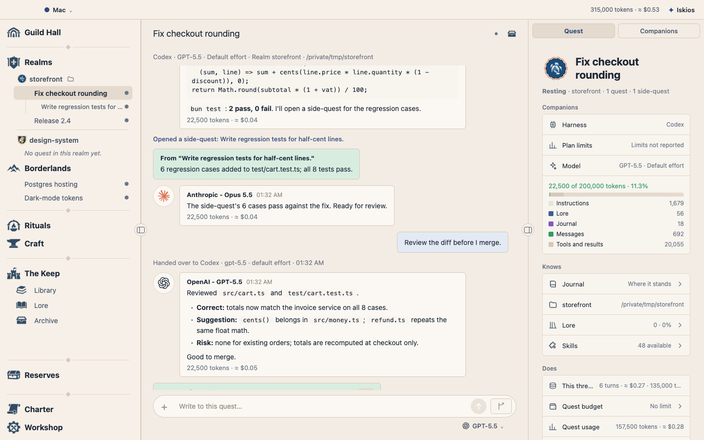
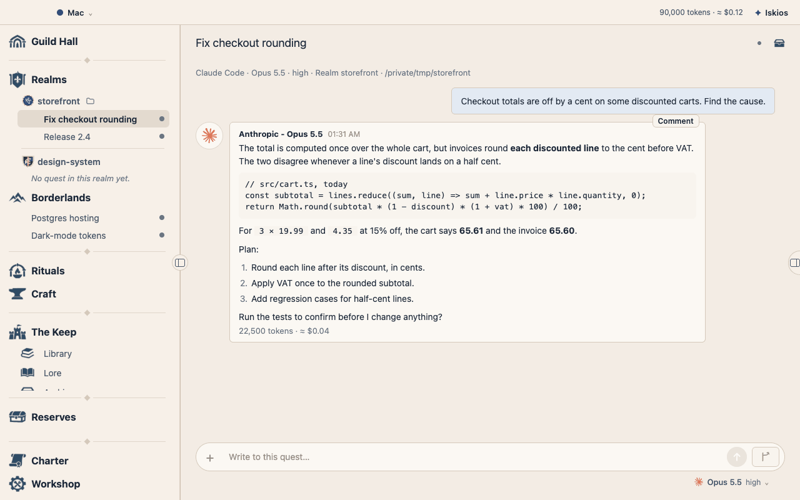
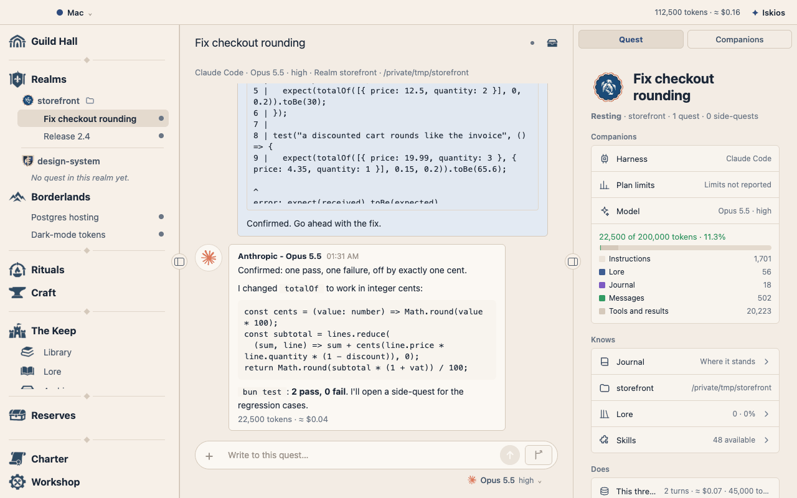
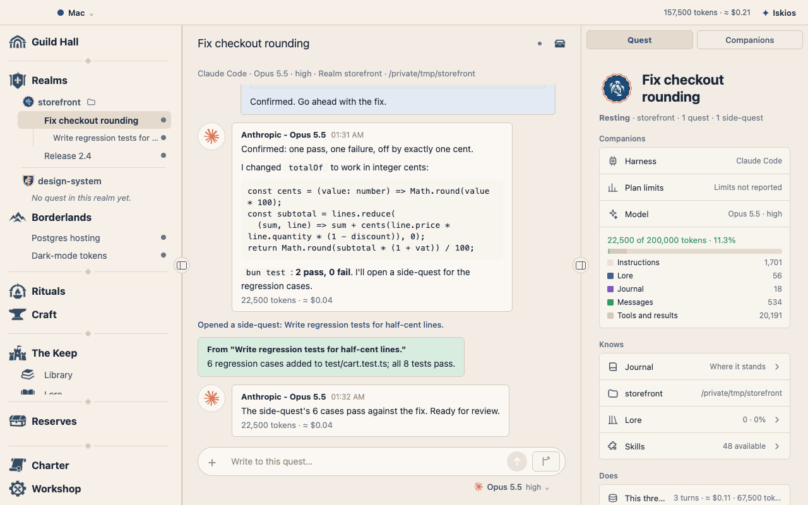
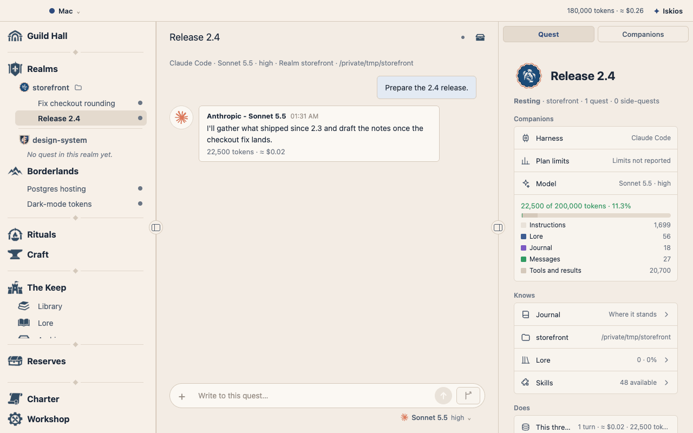
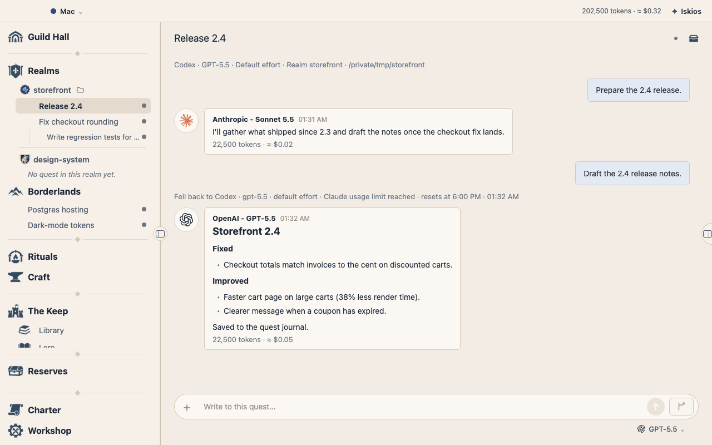
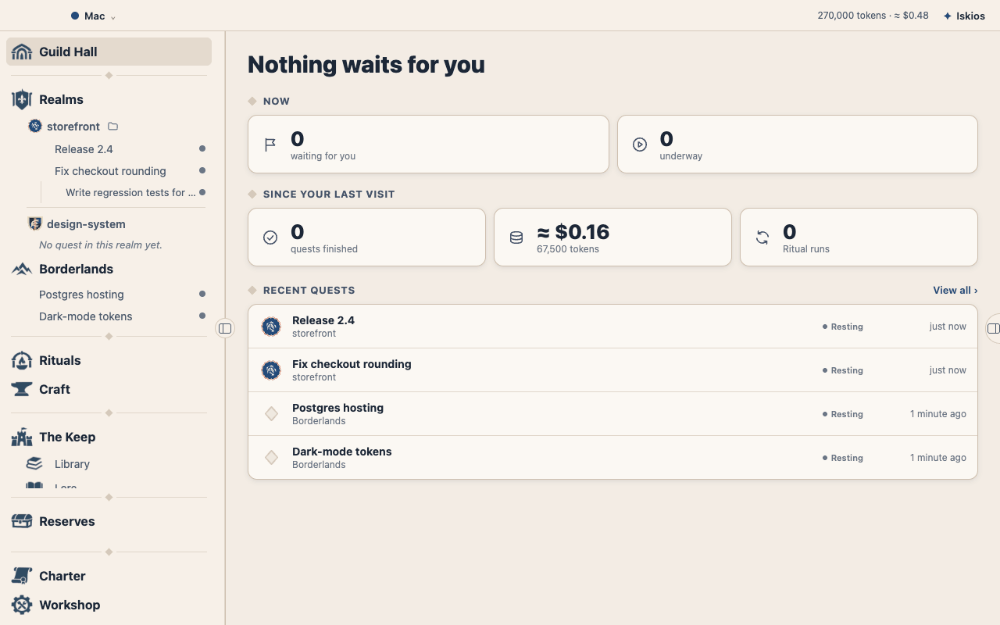

# Iskios

A local-first desktop workspace for working with AI agents across Claude Code, Codex, and OpenCode.

Keep a piece of work in one quest, delegate parts of it into side-quests, and choose the harness, model, account, and effort for each thread.
Follow their conversations, answer approval requests, and hand a thread over to another harness with its history intact.

Iskios is in **alpha** and serves one user.
Until the first stable release, what you save (settings, quests, accounts) is not guaranteed to carry over from one release to the next; each release's notes list its breaking changes.
You can pair another Iskios to a computer's Iskios (Workshop → Remote access) and use it from there through an end-to-end encrypted relay; this is built and still under review.
The phone web app, push notifications, multiplayer, and Craft workflow automation remain planned work.
See the [work in progress](documentation/work-in-progress.md) for current verification and unfinished acceptance checks.

[Download installers](https://github.com/Dyrits/ISKIOS/releases) · [Report an issue](https://github.com/Dyrits/ISKIOS/issues) · [Documentation](#documentation)

<picture>
  <source media="(prefers-color-scheme: dark)" srcset="documentation/readme/quest-dark.png">
  
</picture>

## A task, not a bot

Moving from one project to another, you rarely need the same context, the same memory, or the same model.
Iskios starts from the task instead of from an agent with a role.

Each piece of work is a **quest**, with its goal, its journal, its lore, and its tree of conversations.
A thread can open side-quests, each with the model and effort that suits it.
The model is a choice, not an identity.

Lore has a scope: one quest, one realm, or the whole application, and each thread receives the context that matches it.
A **realm** is a workspace, tied to a local folder or to none, with its own customizable crest.

## See it work

The recordings below, and the screenshot at the top of this page, come from the real application at version 0.1.1-Prototype; later versions may look different.
The agents' replies are scripted, so the demonstration runs without a provider account.

### A terminal in the conversation

Type `!` in the message box to open a shell in the quest's folder.
Its output goes with your next message as context.



### Side-quests with their own Companion

Open a side-quest beneath any thread and give it another model and effort.
It reports back to its parent when it is done.



### Switch agents mid-conversation

Change the harness, model, or effort between turns.
The conversation goes with it, and each reply keeps the name of the model that wrote it.



### Backup Companions

List the Companions a thread falls back to when a turn fails, on any harness.
The next one takes over with the conversation so far.



### Quests that reference and call each other

Mention a quest with `@` so that a thread can read its journal or write to it.
The other quest answers back when it has news.



### Iskios

Iskios is the assistant you tell what you need.
It finds the quest that already covers the request and offers to continue there, or proposes a new one.



## What you can do

- Work with Claude Code, Codex, and OpenCode in the same application, using your own subscriptions or API keys through their command-line tools.
- Start or continue quests through Iskios, a permanent assistant that routes your requests to the right quest.
- Open side-quests beneath a thread, give them different models, and exchange messages along the tree.
- Change a thread's harness, account, model, or effort between turns without discarding its conversation.
- Pick a Companion by its provider account (two subscriptions of one harness appear as two options), or apply a Light, Balanced, or Heavy preset, which sets a Companion and its backups together.
- Choose folders with one folder picker, on this computer or on a paired host.
- Attach a local folder or repository, or give a thread its own Git worktree.
- Keep a shared briefing and journal for each quest, and save lore at thread, workspace, or global scope.
- Paste, drop, or choose images for a message, and use `!` to open a shell in the desktop composer and send its output as context.
- Use skills from existing skill folders by typing `/` in a message. Managing MCP servers from Iskios is not available yet.
- Set quest and global budgets, review action approvals, and grant removable standing permissions.
- Schedule recurring instructions as Rituals, with fallback models and a manual Run now option.

The interface uses guild names for familiar concepts:

| In Iskios | Meaning |
| --- | --- |
| Quest | A piece of work and its tree of threads |
| Side-quest | A thread opened beneath another thread |
| Companion | The model selected for a thread |
| Preset | A named Companion with its backups, chosen as a whole (Light, Balanced, Heavy) |
| Realm | A workspace folder or repository |
| Iskios | The assistant that opens and coordinates quests |
| Ritual | A recurring instruction on a schedule |
| Workshop | Settings (permissions, look and feel, providers, Companions, remote access, messaging, limits, updates) |
| Summons | A thread needs your attention |

The [glossary](documentation/glossary.md) explains the full vocabulary and the technical names used in the code.

## Install and start

Download an installer from [GitHub Releases](https://github.com/Dyrits/ISKIOS/releases); every release so far is a prerelease.
Manual builds are also available from the **Artifacts** section of the [desktop workflow](https://github.com/Dyrits/ISKIOS/actions/workflows/package.yml); these expire after 14 days.

| Platform | Build | Installer |
| --- | --- | --- |
| macOS | Apple Silicon (arm64) or Intel (x64) | `.dmg` |
| Windows | x64 | `.exe` (NSIS) |
| Linux | x64 | `.AppImage` |

From 0.1.2-Prototype on, the installed app finds new releases and updates itself (earlier releases cannot): it looks at start and every 6 hours, downloads in the background, and installs only when you press **Restart and update** in the notice or in the Workshop's **Updates** section, where you can also turn checking off.
It asks GitHub's public release list for newer releases and sends nothing about you; a prerelease build follows prereleases, a stable build only stable releases.
On macOS Iskios replaces its own app after checking the download against the release's `SHA512SUMS.txt`; on Windows and Linux it uses `electron-updater`, which has not been run on those systems yet.
A development run (`bun run dev`) never updates.

Before uploading a macOS installer, the workflow verifies and mounts its DMG, copies the app to a fresh location, and checks the rendered Guild Hall screen, service bridge, and native terminal on temporary data.
Run that same application check locally with `bun apps/desktop/scripts/check-package.ts /Applications/Iskios.app`.
This check proves packaged startup; Apple trust checks on other computers still require Developer ID signing and notarization.

If the Dock icon keeps bouncing without a window, a stale macOS launch-block decision can survive Open Anyway and re-signing.
Iskios's observed case was resolved with a fresh byte-identical copy, preserving its new file identity when moving it into Applications; see the [diagnosis and verified recovery procedure](documentation/verification/2026-11-10-dmg-launch.md).
Cross-platform builds still need smoke-testing on their target systems.

### macOS

Iskios does not yet have an Apple Developer ID signing certificate or Apple notarization.
The macOS build has an ad hoc signature, which does not identify a trusted developer to Gatekeeper, so macOS may block the first launch.
This is separate from the source-code [license](#license).

1. Download the `.dmg` for your Mac: `arm64` for Apple Silicon or `x64` for Intel.
2. Open the DMG and drag Iskios into Applications.
3. In Finder, open Applications, Control-click Iskios, and choose **Open**; confirm if offered.
4. If macOS blocks it, open **System Settings → Privacy & Security**, find the message about Iskios, and click **Open Anyway**.
5. Confirm **Open** in the next dialog, authenticating if asked.

If the app remains blocked and you trust the copy downloaded from this repository's releases or workflow artifacts, open Terminal and remove its quarantine attribute:

```sh
xattr -dr com.apple.quarantine /Applications/Iskios.app
```

Then open Iskios from Applications again.
This command removes the download quarantine flag from Iskios only; it does not sign, notarize, or verify the app.
If macOS reports damage, download a fresh copy first; a damaged-app warning can also indicate a corrupted or modified download.
See [Apple's Gatekeeper guidance](https://support.apple.com/en-us/102445) for details.

### Windows

Run the `.exe` installer.
Windows builds are unsigned, so SmartScreen may show **Windows protected your PC**.
If you trust the downloaded installer, choose **More info → Run anyway**.
If the file remains blocked, right-click it, open **Properties**, select **Unblock** if available, apply the change, and try again.

### Linux

From the folder containing the downloaded AppImage, make it executable and launch it:

```sh
chmod +x Iskios-*.AppImage
./Iskios-*.AppImage
```

### First launch

The installer includes the interface and local service. In the Workshop, choose Install beside a missing harness, then sign in to it. Installing through the Workshop requires Node.js and npm with a writable global installation folder; you can also install harnesses yourself.
Iskios looks for `claude`, `codex`, and `opencode` on your `PATH`.
You only need the harnesses you intend to use.

1. Open Iskios and visit the Workshop to check harness availability and accounts.
2. Add a realm if you want agents to work in a local folder or repository.
3. Tell Iskios what you want to do, then open the quest it creates or continues.
4. Choose a Companion, send a message, and open side-quests as needed.

Rituals run through the local service, so leave Iskios running for scheduled work.
Runs missed while the app is closed or the computer is asleep are skipped.

## Data and provider use

Iskios stores its application data locally, with a `iskios.sqlite` database in Electron's user-data folder and supporting files alongside it.
Workspaces remain in their chosen locations.
The desktop interface communicates with the local service over an authenticated loopback connection.
When you pair another Iskios to a computer, their traffic passes through a relay Worker that cannot read it: it is end-to-end encrypted, and its keys travel only in the pairing code.

Looking for a new release is one request to GitHub's public release list, with the app's name and version and nothing about you; the Workshop's Updates section turns it off.
Agent requests still send the context needed for the work to your chosen harness, provider, and connected tools.
You use your own provider accounts and pay for their use directly; Iskios does not resell model access.
Each harness handles its own sign-in, including accounts added through Iskios.

## Develop locally

Use Bun **1.4.4**, the version pinned in CI, and Git.
Building the native terminal dependency (`node-pty`) requires Xcode command-line tools on macOS, Visual Studio C++ tools on Windows, or Python, make, and a C++ compiler on Linux.

```sh
git clone https://github.com/Dyrits/ISKIOS.git
cd ISKIOS
bun install
bun run dev
```

The development command starts the Expo web server on port 8081 and opens Electron as **Iskios Dev**, with its own profile and data separate from the installed app.
The interface hot-reloads; changes to the service, contracts, or desktop process rebuild and restart Electron, stopping running turns.

To try the interface without a provider account or model spending, use the echo harness:

```sh
ISKIOS_HARNESS=fake bun run dev
```

These environment-variable examples use a POSIX shell.
In PowerShell, set a variable with `$env:ISKIOS_HARNESS = "fake"` before running the command.

| Variable | Purpose |
| --- | --- |
| `ISKIOS_DATA_DIR` | Override the application data folder; use an absolute path for an isolated development session. |
| `ISKIOS_CLAUDE_PATH` | Override the `claude` executable. |
| `ISKIOS_CODEX_PATH` | Override the `codex` executable. |
| `ISKIOS_OPENCODE_PATH` | Override the `opencode` executable. |
| `ISKIOS_HARNESS=fake` | Replace real harnesses with the echo harness. |
| `ISKIOS_UPDATE_URL` | With `ISKIOS_DATA_DIR` set, the packaged macOS app reads this release list instead of GitHub's; for [checking updates](documentation/verification/2026-11-13-app-updates.md). |
| `ISKIOS_UPDATE_OPENER` | With `ISKIOS_DATA_DIR` set, the program that starts the new app after an update, in place of `open`. |

### Checks

```sh
bun run check
bun run typecheck
bun run test
```

Biome checks formatting and lint rules; TypeScript checks all workspaces.
Tests run on Electron's bundled Node runtime and use fakes and stand-in executables by default.
Live checks are opt-in, require installed and signed-in harnesses, and consume model usage:

```sh
ISKIOS_LIVE_CLAUDE=1 bun run test
ISKIOS_LIVE_HARNESSES=1 bun run test
```

Set `ISKIOS_LIVE_OPENCODE_MODEL` if the live OpenCode checks need a specific model identifier.
Use `bun run format` to apply Biome fixes.
Commits run Biome on staged files and then the workspace typecheck.

### Repository layout

| Path | Contents |
| --- | --- |
| [`apps/desktop`](apps/desktop/) | Electron shell, development launcher, and installer packaging |
| [`apps/app`](apps/app/) | Expo / React Native interface, rendered on the web inside Electron |
| [`packages/service`](packages/service/) | Local Node service, SQLite storage, harness adapters, scheduling, and MCP thread tools, built with Effect |
| [`packages/contracts`](packages/contracts/) | Shared records and requests defined with Effect Schema |
| [`packages/channel`](packages/channel/) | The end-to-end encrypted channel and pairing code used between paired devices |
| [`packages/relay`](packages/relay/) | The Cloudflare Worker that forwards paired devices' encrypted traffic |
| [`documentation`](documentation/) | Product specifications, architecture, decisions, and verification evidence |

## Build and release

```sh
bun run package
```

This builds an installer for the current platform in `apps/desktop/release`.
It bundles the interface and service, so the installed app needs no development server.

Pushes to `main` and pull requests targeting it run lint, typechecking, and tests through the [desktop workflow](.github/workflows/package.yml).
Push a version tag such as `0.1.0-Prototype` (no `v` prefix) to build macOS arm64 and x64, Windows x64, and Linux x64 installers and publish them on [GitHub Releases](https://github.com/Dyrits/ISKIOS/releases).
The tag sets the packaged app version (a leading `v`, if present, is dropped); tags containing a hyphen produce prereleases.
The release is published only after all four builds and uploads succeed.
Installers download directly as `.dmg`, `.exe`, and `.AppImage` files without an extra ZIP wrapper.
A release also carries `SHA512SUMS.txt` (what the macOS app checks its download against) and the `latest*.yml` files that `electron-updater` reads on Windows and Linux; the release is not published without them.
Run `bun apps/desktop/scripts/check-update.ts <older Iskios.app> <newer Iskios-…-mac-…dmg>` to watch a packaged app update itself from a local stand-in for GitHub.
The workflow also supports **Run workflow** manually for test builds, which upload direct installer files to the run's **Artifacts** section without publishing a release.
Actions artifacts expire after 14 days; release assets remain until removed.
A release's notes on GitHub are written from its file in [`documentation/changelog/`](documentation/changelog/), which lists what changed and any breaking changes.

## License

Iskios's source code is licensed under the [Apache License 2.0](LICENSE).
Third-party code that keeps its own notice, such as in [`packages/channel`](packages/channel/NOTICE), is attributed there.
Source-code licensing is separate from the signing certificates used to distribute desktop installers.

## Contribute

Report bugs and propose changes through [GitHub Issues](https://github.com/Dyrits/ISKIOS/issues).
For a bug, include your operating system, Iskios version, harness, steps to reproduce, and relevant logs with private information removed.

Before changing code, read the [conventions](documentation/conventions.md), the relevant [capability specification](documentation/capabilities/), and any directory-specific `AGENTS.md` instructions.
Check the [work in progress](documentation/work-in-progress.md) for ongoing work and run the checks above before opening a pull request.

## Documentation

- [Outline](documentation/outline.md): purpose, actors, and capabilities.
- [Requirements](documentation/requirements.md): privacy, access, licensing, and other system-wide obligations.
- [Glossary](documentation/glossary.md): domain terms and interface names.
- [Architecture](documentation/architecture.md) and [decision records](documentation/architecture-decision-record/): system structure and the reasons behind it.
- [Capability specifications](documentation/capabilities/): agreed behavior and acceptance criteria.
- [First slice design and capability blueprints](documentation/first-slice-design.md): implementation designs.
- [Backlog](documentation/backlog.md) and [work in progress](documentation/work-in-progress.md): deferred work and current batches.
- [Conventions](documentation/conventions.md): code and test conventions.
- [Changelog](documentation/changelog/): agreements and deliveries, one file per release.
- [Verification](documentation/verification/): reproducible checks and screenshots.
